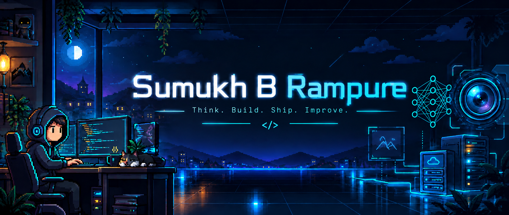

  

  <strong>Think. Build. Ship. Improve.</strong> 
  Computer Engineering Student · Software Development · AI & Computer Vision

  
  
  

👋 About Me
Hey! I'm Sumukh B Rampure, a Computer Engineering student who enjoys turning ideas into useful software.
- 💻 Interested in backend development, AI, computer vision, and web development
- 🧠 Building practical projects that combine APIs, databases, and intelligent systems
- 🛠️ Currently gaining industry experience at CodeFlurry Technologies
- 🌱 Always learning, experimenting, and improving through hands-on projects
I believe good software comes from curiosity, consistent practice, and learning by building.

🧰 Tech Stack

  

🚀 Featured Projects
<table>
  <tr>
    <td width="50%" valign="top">
      <h3>🎯 FrameSense</h3>
      
<strong>AI-Powered FPS Game Performance Analyzer</strong>

      
Analyzes FPS gameplay footage to explore aim accuracy, reaction time, movement, and performance trends.

      
<code>Python</code> <code>YOLOv8</code> <code>OpenCV</code> <code>FastAPI</code>

      
🏆 <strong>3rd Place</strong> — Mini Project Expo 2026

      
<a href="https://github.com/SBR-sys/Framesense">Browse repositories ↗</a>

    </td>
    <td width="50%" valign="top">
      <h3>🎮 Mystic Arcade</h3>
      
<strong>Gaming Café Management System</strong>

      
A database-driven application for gaming station bookings, session management, and billing workflows.

      
<code>Python</code> <code>FastAPI</code> <code>MySQL</code> <code>HTML/CSS</code>

      
<a href="https://github.com/SBR-sys?tab=repositories">Browse repositories ↗</a>

    </td>
  </tr>
  <tr>
    <td width="50%" valign="top">
      <h3>🩸 Blood Bank Management System</h3>
      
<strong>Blood Inventory & Request Management</strong>

      
Manages donors, hospitals, staff, inventory, and blood requests with role-based access for different users.

      
<code>PHP</code> <code>MySQL</code> <code>JavaScript</code>

      
<a href="https://github.com/SBR-sys/blood-bank-management-system">Browse repositories ↗</a>

    </td>
    <td width="50%" valign="top">
      <h3>🦷 OralGuard AI</h3>
      
<strong>AI-Based Oral Condition Screening</strong>

      
In-development computer vision project exploring CNN-based tongue and oral-condition image classification, with attention to image variation and augmentation.

      
<code>Python</code> <code>CNN</code> <code>OpenCV</code>

      
<em>🚧 In development</em>

      
<a href="https://github.com/SBR-sys?tab=repositories">Browse repositories ↗</a>

    </td>
  </tr>
</table>

  <a href="https://sbr-sys.github.io/SBR_portfolio/"><strong>Explore my portfolio →</strong></a>
  &nbsp; · &nbsp;
  <a href="https://github.com/SBR-sys?tab=repositories"><strong>All repositories →</strong></a>

💼 Experience
Software Development Intern · CodeFlurry Technologies
Mysore, Karnataka · September 2026 – Present
- Contributing to the development of Gramshala, a WhatsApp automation project for Gram Panchayat communications.
- Building and refining n8n workflows for notifications and information delivery.
- Exploring RAG-based document retrieval to support information access and user queries.
Project details reflect the current scope and should be updated as implementation progresses.
🏆 Achievement
- 3rd Place — Mini Project Expo 2026, Department of Computer Engineering, Maharaja Institute of Technology, Mysore, for FrameSense.
📊 GitHub Activity

  
  

  

📫 Let's Connect
I'm always happy to connect with developers, learn from others, and collaborate on interesting ideas.
- 🌐 Portfolio: https://sbr-sys.github.io/SBR_portfolio/
- 💻 GitHub: https://github.com/SBR-sys
- ✉️ Email: sumukhbrampure@gmail.com

  <strong>Building today. Learning every day. Improving with every commit. 💙</strong>

