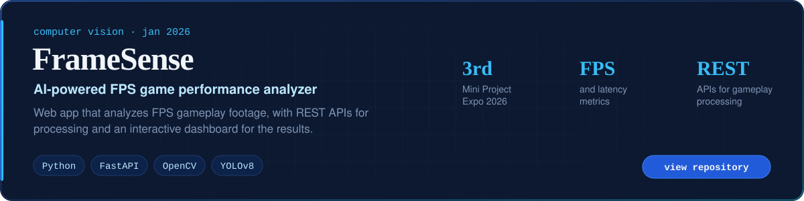
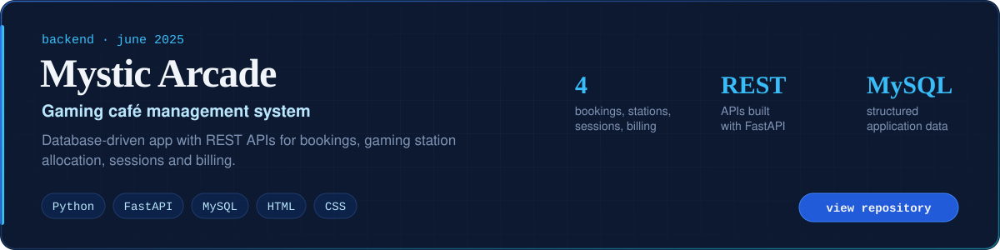
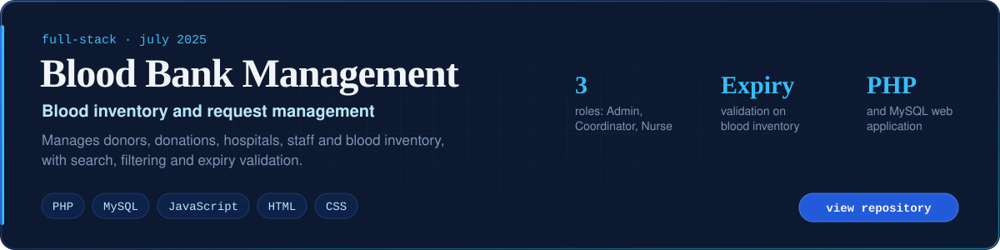
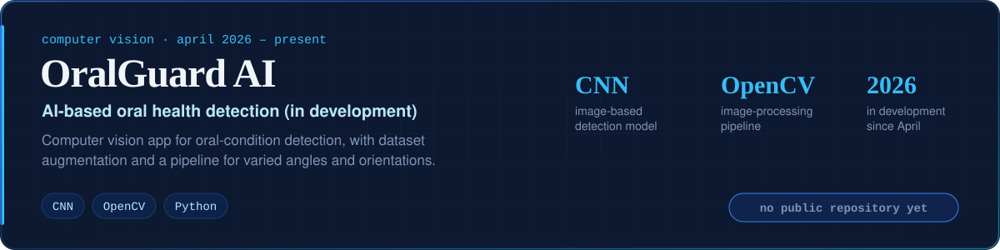
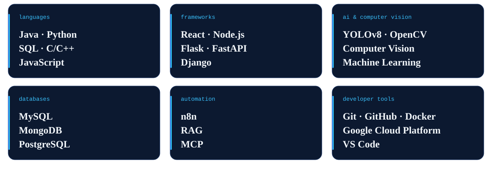
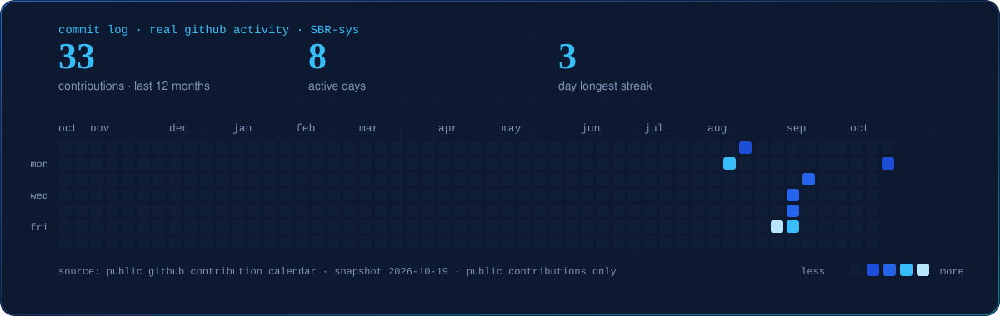

 <picture> <source media="(prefers-reduced-motion: reduce)" srcset="./hero-static.svg">  </picture> 
 
     
 

I'm a computer engineering student in Mysuru who likes turning ideas into working software. My projects sit where backend APIs, databases and computer vision meet. Right now I'm a Software Development Intern at CodeFlurry Technologies, working on Gramshala, a WhatsApp automation project for Gram Panchayat communications.

 <picture> <source media="(prefers-reduced-motion: reduce)" srcset="./terminal-static.svg">  </picture> 

Achievement: 3rd Place, Mini Project Expo 2026, Department of Computer Engineering, Maharaja Institute of Technology Mysore, for FrameSense.

     
 <picture> <source media="(prefers-reduced-motion: reduce)" srcset="./footer-static.svg">  </picture> 

